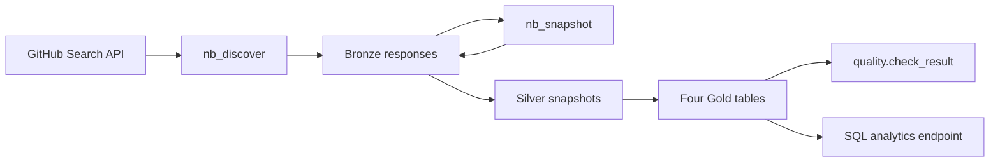

# GitHub Ecosystem Intelligence

A Microsoft Fabric project that collects public GitHub repositories and keeps a history of how they change. The first phase discovers repositories in a small set of technology areas, snapshots the ones it tracks, and publishes Bronze, Silver, and Gold Delta tables.

The questions it is built to answer are where new repositories are appearing, which tracked repositories are gaining stars, and how languages and topics are distributed.

## Work in progress

Phase 1 source is in the repository: notebooks, ingestion rules, quality checks, and setup notes. Creating the Fabric workspace, storing a GitHub token in Key Vault, and running the pipeline are the remaining steps in [docs/setup.md](docs/setup.md). Later phases are planned and not started.

## Architecture



One schema-enabled lakehouse, `lh_ecosystem`. PySpark notebooks do the collection and transforms. A Data Factory pipeline is specified and still needs real Fabric ids before it can be synced.

Details: [architecture/architecture.md](architecture/architecture.md) and [AGENTS.md](AGENTS.md).

## Stack

Microsoft Fabric, OneLake, Lakehouse, Data Factory, PySpark, Spark SQL, Delta Lake, and the SQL analytics endpoint. GitHub holds the notebooks, rules, and docs. Fabric itself runs only in Microsoft's cloud.

## Status

Phase 1 source is in the repository and has not been executed in a Fabric workspace. Local pytest covers the collection rules and checks that the notebooks still match them. It does not call the GitHub API or create tables.

## Roadmap

1. **Fabric foundations.** Discover repositories, snapshot them, and publish Bronze, Silver, and Gold. This phase is the current work.
2. **Portable operator.** A separate later implementation with Python, GitHub Actions, Parquet, DuckDB, and an optional Streamlit app. Not started.
3. **Wider collection.** More catalogue queries, incremental derived tables, scheduling, and monitoring. Not started.
4. **Learning extension.** Early repository traction prediction. Not started.

## Start here

- What is and is not stored locally: [data/README.md](data/README.md)
- Portal setup and what remains manual: [docs/setup.md](docs/setup.md)
- Tables and grain: [docs/data-model.md](docs/data-model.md)
- Decisions: [docs/decisions.md](docs/decisions.md)
- Agent and contributor guide: [AGENTS.md](AGENTS.md)

```bash
python -m pip install -r requirements-dev.txt
python -m pytest
```
