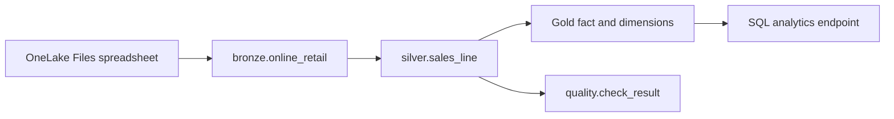

# ABC Retail Intelligence

A Microsoft Fabric demo of a retail analytics platform. The first phase lands UCI Online Retail II in a lakehouse and models it as Bronze, Silver, and Gold Delta tables.

The business question is retail performance and customer intelligence: revenue, products, repeat purchase, returns, and geography.

## Architecture



One schema-enabled lakehouse, `lh_retail`. PySpark notebooks do the transforms. A Data Factory pipeline is specified and still needs real Fabric ids before it can be synced. Power BI is Phase 2.

Details: [architecture/architecture.md](architecture/architecture.md) and [AGENTS.md](AGENTS.md).

## Stack

Microsoft Fabric, OneLake, Lakehouse, Data Factory, PySpark, Spark SQL, Delta Lake, SQL analytics endpoint, and later Power BI. GitHub holds the notebooks, rules, and docs. Fabric itself runs only in Microsoft's cloud.

## Status

Phase 1 source is in the repository and has not been executed in a Fabric workspace. Local pytest covers the business rules and checks that the notebooks still match them. It does not load the spreadsheet or create tables.

## Roadmap

1. **Fabric foundations.** Ingest the spreadsheet and publish Bronze, Silver, and Gold. This phase is the current work.
2. **Business intelligence.** A Power BI semantic model and a three-page retail report. Not started.
3. **Production practices.** Incremental merges, scheduling, and a promotion path. Not started.
4. **AI extension.** A separate read-only assistant over the Gold model. Not started.

## Start here

- Dataset location and licence: [data/README.md](data/README.md)
- Portal setup and what remains manual: [docs/setup.md](docs/setup.md)
- Tables and grain: [docs/data-model.md](docs/data-model.md)
- Decisions: [docs/decisions.md](docs/decisions.md)
- Agent and contributor guide: [AGENTS.md](AGENTS.md)

```bash
python -m pip install -r requirements-dev.txt
python -m pytest
```
