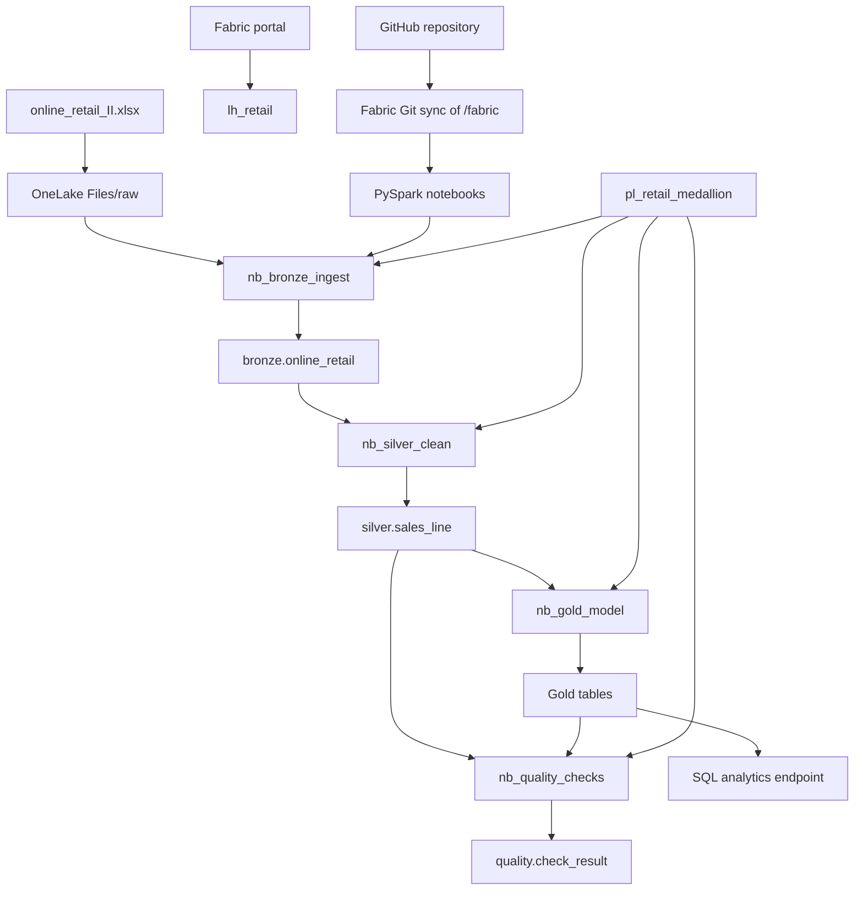

# Architecture

ABC Retail Intelligence uses one Microsoft Fabric lakehouse and the Medallion pattern. Phase 1 stops at curated Delta tables and T-SQL access. Reports and an AI assistant are later phases.

## Platform

Fabric is the only execution environment. Nothing in this repository starts a local Spark cluster or a local Fabric substitute.

## Why one lakehouse

Bronze, Silver, Gold, and quality results are schemas in `lh_retail`: `bronze`, `silver`, `gold`, and `quality`.

One lakehouse matches the Phase 1 scope. The SQL analytics endpoint is created with the lakehouse, so T-SQL does not need a Warehouse. A Warehouse, and a lakehouse-per-layer split, can be reconsidered in Phase 3 if promotion or workload isolation needs it.

Lakehouse schemas are chosen at creation and cannot be enabled afterwards. [docs/setup.md](../docs/setup.md) makes that a blocking portal step.

## Files and Tables

| OneLake area | What is stored | How it is used |
| --- | --- | --- |
| `Files/raw/online_retail_II.xlsx` | The original workbook | Notebook input. Not a table. Not in Git. |
| `Tables/bronze`, `Tables/silver`, `Tables/gold`, `Tables/quality` | Delta tables | Spark writes them. The SQL analytics endpoint reads them. |

Git does not version lakehouse tables or files. Syncing the branch will not upload the spreadsheet and will not overwrite table data.

## What runs where

| Step | API | Notebook |
| --- | --- | --- |
| Read both sheets, add batch metadata, append | PySpark, with a pandas fallback if the runtime has no Excel source | `nb_bronze_ingest` |
| Type, classify, deduplicate, drop incomplete lines | DataFrame API | `nb_silver_clean` |
| Build dimensions and the sales fact | Spark SQL | `nb_gold_model` |
| Recompute expectations and fail on critical checks | PySpark | `nb_quality_checks` |
| Orchestrate the four notebooks | Data Factory pipeline | `pl_retail_medallion` (template only until ids exist) |
| Ad hoc business checks | T-SQL | [docs/validation.sql](../docs/validation.sql), run by a person in the SQL analytics endpoint |

The pipeline template is documentation until workspace and notebook GUIDs exist. Notebook activities cannot point at a notebook by name alone.

## Incremental behaviour in Phase 1

Bronze is append-only by `ingestion_batch_id`. The same id is skipped.

Silver and Gold are overwritten from the batch with the latest `ingestion_timestamp`. That gives a repeatable downstream result without `MERGE`. Historical Bronze batches stay available. Phase 3 is the place for upserts and watermarks.

## Git integration

Connect the workspace to this repository, branch `main`, root directory `/fabric`.

Tracked from this repo on the first sync:

- `fabric/notebooks/nb_bronze_ingest.Notebook`
- `fabric/notebooks/nb_silver_clean.Notebook`
- `fabric/notebooks/nb_gold_model.Notebook`
- `fabric/notebooks/nb_quality_checks.Notebook`

Each item folder has `notebook-content.py` and a version-2 `.platform` file. Logical ids are unique and must not be reused.

Not in the first sync, on purpose:

- The lakehouse item. Create `lh_retail` in the portal with schemas enabled, then commit the folder Fabric generates.
- The pipeline item. Copy [docs/pipeline-template.json](../docs/pipeline-template.json) into `fabric/pipelines/pl_retail_medallion.DataPipeline/` only after replacing the placeholder ids.

Notebooks are committed without a default lakehouse id. After the first sync, attach `lh_retail` in the notebook settings and commit the metadata Fabric writes.

## Security

The public repository must not contain the spreadsheet, API keys, access tokens, or connection strings. Fabric permissions are managed in the workspace. Phase 1 does not add OneLake data-access roles or a deployment pipeline.
