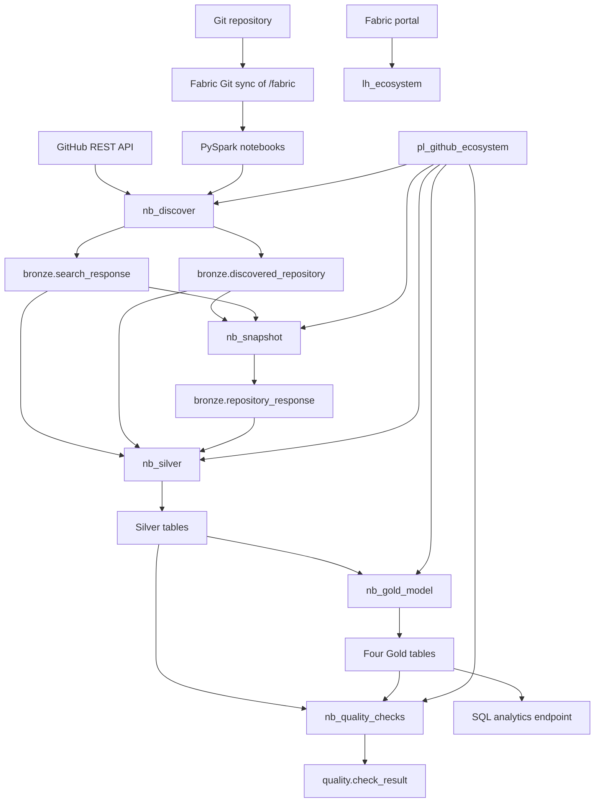

# Architecture

GitHub Ecosystem Intelligence uses one Microsoft Fabric lakehouse and the Medallion pattern. Phase 1 stops at curated Delta tables and T-SQL access. A portable operator and a learning model are later phases.

## Platform

Fabric is the execution environment for this phase. Nothing in this repository starts a local Spark cluster or a local Fabric substitute. The GitHub calls run on the notebook driver, one request after another. Spark does not parallelise the API.

## Why one lakehouse

Bronze, Silver, Gold, and quality results are schemas in `lh_ecosystem`: `bronze`, `silver`, `gold`, and `quality`.

One lakehouse matches the Phase 1 scope. The SQL analytics endpoint is created with the lakehouse, so T-SQL does not need a Warehouse. A Warehouse, and a lakehouse-per-layer split, can be reconsidered later if promotion or workload isolation needs it.

Lakehouse schemas are chosen at creation and cannot be enabled afterwards. [docs/setup.md](../docs/setup.md) makes that a blocking portal step.

## Files and tables

GitHub is the source. The notebooks do not read a file from OneLake. They write Delta tables under `Tables/bronze`, `Tables/silver`, `Tables/gold`, and `Tables/quality`. The SQL analytics endpoint reads those tables. It is not a second copy of the data.

Git does not version lakehouse tables. Syncing the branch will not call GitHub and will not overwrite table data.

## What runs where

| Step | API | Notebook |
| --- | --- | --- |
| Search the catalogue, append raw pages and discovered repositories | Python HTTP client, then a Delta append | `nb_discover` |
| Refresh tracked repositories, append raw responses | Python HTTP client, then a Delta append | `nb_snapshot` |
| Type responses, carry `304` metrics forward, rebuild registry | DataFrame API | `nb_silver` |
| Build the four analytical tables | Spark SQL | `nb_gold_model` |
| Recompute expectations and fail on critical checks | PySpark | `nb_quality_checks` |
| Orchestrate the five notebooks | Data Factory pipeline | `pl_github_ecosystem` (template only until ids exist) |
| Ad hoc analytical checks | T-SQL | [docs/validation.sql](../docs/validation.sql), run by a person in the SQL analytics endpoint |

The pipeline template is documentation until workspace and notebook GUIDs exist. Notebook activities cannot point at a notebook by name alone.

## Incremental behaviour in Phase 1

Discovery and snapshot are incremental. A `collection_run_id` that is already stored is not requested again. Monitoring also sends `If-None-Match`. A `304` does not use the core rate limit, and Silver copies the previous repository body forward.

Silver and Gold are full rebuilds of everything Bronze has kept. That preserves one snapshot series without a merge. The volume at the default cap of 500 tracked repositories is small enough for a learning pipeline. Phase 3 is the place for incremental derived tables.

## Git integration

Connect the workspace to this repository, branch `main`, root directory `/fabric`.

Tracked from this repo on the first sync:

- `fabric/notebooks/nb_discover.Notebook`
- `fabric/notebooks/nb_snapshot.Notebook`
- `fabric/notebooks/nb_silver.Notebook`
- `fabric/notebooks/nb_gold_model.Notebook`
- `fabric/notebooks/nb_quality_checks.Notebook`

Each item folder has `notebook-content.py` and a version-2 `.platform` file. Logical ids are unique and must not be reused.

Not in the first sync, on purpose:

- The lakehouse item. Create `lh_ecosystem` in the portal with schemas enabled, then commit the folder Fabric generates.
- The pipeline item. Copy [docs/pipeline-template.json](../docs/pipeline-template.json) into `fabric/pipelines/pl_github_ecosystem.DataPipeline/` only after replacing the placeholder ids.

Notebooks are committed without a default lakehouse id. After the first sync, attach `lh_ecosystem` in the notebook settings and commit the metadata Fabric writes.

`src/` is not deployed by that sync. The ingestion notebooks therefore contain a copy of the tested client and rules. The parity test is what keeps the copy honest.

## Security

The public repository must not contain GitHub tokens, Key Vault secrets, or bulk API dumps. The notebooks read the token with `notebookutils.credentials.getSecret` from the vault URL supplied as a parameter. They do not print the token. Fabric permissions are managed in the workspace. Phase 1 does not add OneLake data-access roles or a deployment pipeline.

## Later portability

Phase 2 can call the same `src/` functions and write the same column names to Parquet. This repository does not build that operator. It also does not add an interface layer in front of Fabric. The portable parts are ordinary functions and ordinary tables.
